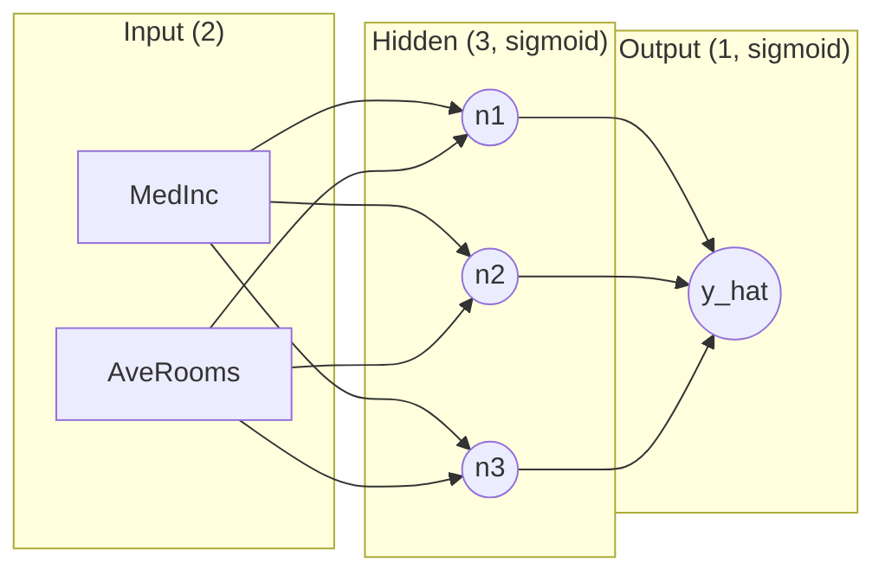
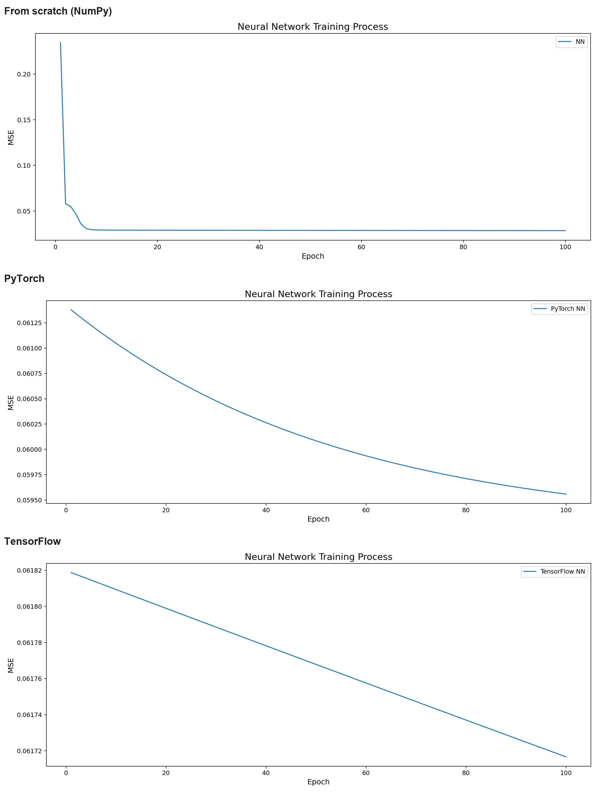

# Neural Network from Scratch: NumPy vs. PyTorch vs. TensorFlow

**California Housing price regression with a hand-coded 2–3–1 feed-forward network, reproduced and compared in PyTorch and TensorFlow.**

## Overview

This project builds the same small feed-forward neural network three times. First entirely by hand in NumPy — forward propagation, backpropagation, and the gradient-descent update rule written out explicitly, with no automatic differentiation — then again with the identical architecture in PyTorch and in TensorFlow. Every version shares the same dataset, preprocessing, and hyperparameters, so the only real differences are how the network and its training loop are expressed. That makes the three implementations a clean, verifiable demonstration of what each framework automates.

The repository contains two notebooks, matching script versions, and the training curves produced by each run.

## At a glance

| | |
| --- | --- |
| **Task** | Regression — predict a neighborhood's median house value |
| **Data** | California Housing: first 10,000 rows, 2 features (`MedInc`, `AveRooms`) |
| **Model** | 2 → 3 → 1 feed-forward network, sigmoid activations, 13 parameters |
| **Training** | MSE loss, gradient descent, learning rate 0.05, 100 epochs |
| **Implementations** | NumPy (from scratch), PyTorch, TensorFlow |
| **Best recorded test MSE** | 0.0575 (PyTorch) |

## Motivation

Predicting median house value is a continuous-target regression problem. The purpose of this project is not to chase accuracy on a benchmark but to make the mechanics of neural-network training explicit: how signals move forward through the network, how gradients are derived and propagated backward, and how a weight update actually looks before an autograd engine hides it. Re-implementing the same model in two frameworks then turns the exercise into a comparison — the same math, expressed three ways.

## Objectives

- Write forward propagation, backpropagation, and the weight/bias update by hand in NumPy.
- Reproduce the exact architecture and loss in PyTorch and TensorFlow.
- Keep the data pipeline identical across all three so the comparison is meaningful.
- Compare convergence between a manual per-sample update loop and the frameworks' optimizers.
- Visualize and interpret the training progress of each implementation.

## Dataset and preprocessing

**Source:** scikit-learn's `fetch_california_housing`, loaded directly in code — no local data files.

The full dataset has 20,640 rows and 8 numeric features. This project deliberately uses a small slice of it:

1. Load the features and target into a pandas `DataFrame`.
2. Min–max scale `MedInc`, `AveRooms`, and `Target` to `[0, 1]` with `MinMaxScaler`.
3. Take the first 10,000 rows, using the two features as input and the target as the label.
4. Split 67/33 with `train_test_split(test_size=0.33, random_state=42)` → **6,700 training** and **3,300 test** samples (the test set is held out).

There is no separate validation split.

## Model and training

All three implementations share one architecture: **2 inputs → 3 hidden neurons → 1 output**, with a sigmoid activation on the hidden and output layers — nine weights and four biases, thirteen trainable parameters in total. The loss is mean squared error, optimized with gradient descent at a learning rate of `0.05` for `100` epochs.



The from-scratch implementation follows directly from this diagram. For a single sample,

$$n_i = \sigma\!\left(w_{2i-1}\,x_1 + w_{2i}\,x_2 + b_{n_i}\right), \quad i \in \{1,2,3\}, \qquad
\hat{y} = \sigma\!\left(w_7 n_1 + w_8 n_2 + w_9 n_3 + b_{\hat{y}}\right),$$

with $\sigma(z) = 1/(1+e^{-z})$ and $\sigma'(z) = \sigma(z)\,(1-\sigma(z))$. Each parameter is then moved down the gradient of the squared error,

$$\theta \leftarrow \theta - \eta \,\frac{\partial}{\partial\theta}\,(\hat{y}-y)^2,$$

which is exactly what the NumPy code computes by hand and what the frameworks compute with autograd.

### How the three implementations differ

| | NumPy (`NN.ipynb`) | PyTorch (`Mix.ipynb`) | TensorFlow (`Mix.ipynb`) |
| --- | --- | --- | --- |
| **Layers** | manual weights `w1`–`w9` + biases | `nn.Linear(2,3)` → `nn.Linear(3,1)` | `Dense(3,'sigmoid')` → `Dense(1,'sigmoid')` |
| **Forward pass** | explicit arithmetic | `model(x)` | `model(x)` |
| **Backward pass** | hand-derived chain rule | autograd (`loss.backward()`) | autograd (`tf.GradientTape`) |
| **Optimizer** | manual gradient descent | `optim.SGD(lr=0.05)` | `optimizers.SGD(0.05)` |
| **Update frequency** | once per sample (~6,700 per epoch) | once per epoch (full batch) | once per epoch (full batch) |

The update-frequency row is the key one: the from-scratch loop runs a full backward pass for *every* training sample, while the framework loops take a single step over the whole batch each epoch. Same learning rate, same epoch count — very different numbers of updates.

## Technologies

- **Python** (notebooks ran on 3.12.1)
- **NumPy** and **pandas** for the numerical core and data handling
- **scikit-learn** for dataset loading, `MinMaxScaler`, `train_test_split`, and `mean_squared_error`
- **Matplotlib** for the training curves
- **PyTorch** (`torch.nn`, `torch.optim`)
- **TensorFlow / Keras** (model subclassing, `Dense`, losses, optimizers, `GradientTape`)
- **Jupyter** notebooks

## Repository structure

```
.
├── NN.ipynb                          # From-scratch NumPy network
├── numpy_from_scratch.py             # Script version (NumPy)
├── Mix.ipynb                         # PyTorch and TensorFlow implementations
├── pytorch_model.py                  # Script version (PyTorch)
├── tensorflow_model.py               # Script version (TensorFlow)
├── requirements.txt                  # Python dependencies
├── figures/
│   ├── training_curves_comparison.png  # All three curves, stacked
│   ├── numpy_training_curve.png
│   ├── pytorch_training_curve.png
│   └── tensorflow_training_curve.png
└── .gitignore
```

## Setup

Install the dependencies from the included requirements file (or install the packages individually):

```bash
pip install -r requirements.txt
# or: pip install numpy pandas matplotlib scikit-learn torch tensorflow jupyter
```

scikit-learn downloads the California Housing dataset the first time it is called, so an internet connection is required on the first run.

## Running the project

**Notebooks (recommended).** Start Jupyter and run all cells:

```bash
jupyter notebook
```

- `NN.ipynb` — the from-scratch NumPy implementation
- `Mix.ipynb` — the PyTorch and TensorFlow implementations, top to bottom

**Scripts.** Each prints the loss for every epoch and opens a Matplotlib window with the training curve:

```bash
python numpy_from_scratch.py   # from-scratch NumPy
python pytorch_model.py        # PyTorch
python tensorflow_model.py     # TensorFlow
```

## Results

Loss values as recorded in the saved notebook outputs:

| Implementation | Loss, epoch 1 | Loss, epoch 100 | Test MSE |
| --- | --- | --- | --- |
| **NumPy** (from scratch) | 0.2343 | 0.0284 | — |
| **PyTorch** | 0.0614 | 0.0596 | **0.0575** |
| **TensorFlow** | 0.0618 | 0.0617 | 0.0596 |

**How to read this table.** The three runs are not measured identically, and the difference matters:

- The **NumPy** numbers are the training MSE, recomputed every epoch, from a loop that takes a gradient step for every sample. The framework numbers are the training loss of a single full-batch step per epoch. The from-scratch figure is lower largely because it performs roughly 6,700× more updates in the same 100 epochs — a training-regime difference, not evidence that the manual implementation is better.
- Only the framework runs report a **test MSE**. The from-scratch model is evaluated on the training set only.
- The target was min–max scaled, so all values are in scaled target units. A test MSE of 0.0575 corresponds to a root-mean-squared error of about **0.24** in scaled units.

## Training curves

The figure below stacks the three training curves produced by the runs. The NumPy curve collapses within the first few epochs and then holds flat (its per-sample loop converges almost immediately), while the PyTorch and TensorFlow curves descend smoothly — a direct visual of the update-frequency difference described above.



## Key findings

- The hand-written backpropagation trains the network correctly. Its loss falls sharply and then stabilizes, and the model behaves like the framework versions, which validates the manual gradient derivation.
- Updating once per sample reaches a much lower training loss inside the same 100 epochs than a single full-batch step, purely because it takes far more parameter updates per epoch. This is a property of the training loop, not of the language or framework.
- Confining the output to `[0, 1]` with a sigmoid and a scaled target, and using only two input features, keeps test error relatively high. Both are expected consequences of the deliberately minimal setup.

## Limitations

- The scaler is fit on the full dataset **before** the train/test split, so scaling statistics leak information from the test set.
- Only 10,000 of 20,640 rows and 2 of 8 features are used, leaving much of the available signal unused.
- The from-scratch model is never evaluated on the held-out test set, so it has no comparable test score.
- A single seeded split is used; there is no validation set and no early stopping.
- NumPy weight initialization is unseeded, so the from-scratch run is not fully reproducible.

## Future work

- Fit the scaler on the training split only, and use all rows and all features.
- Add a validation split and score every implementation on the same held-out test set.
- Compare against baseline regressors such as linear regression or gradient boosting.
- Move to a linear output unit to remove the sigmoid range limitation.
- Add a `requirements.txt` and seed the weight initialization for reproducibility.

## Author

Ibrahim Mohamed Mahrous (2203186) — Neural Networks course project.
